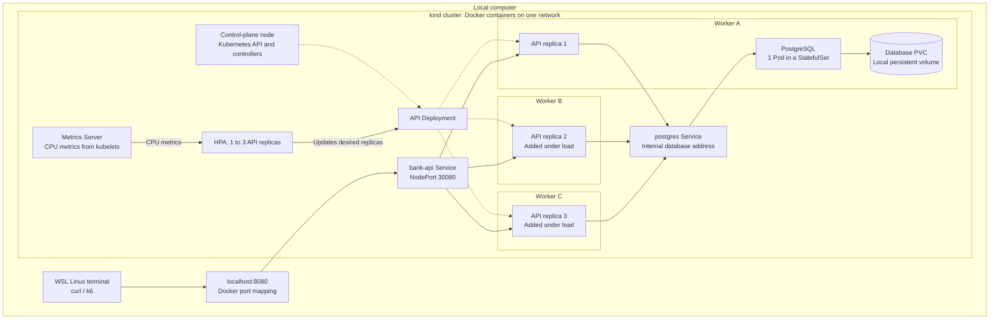

Planned architecture, shown at three API replicas. kind provides one control-plane node and three workers. A Service routes requests to ready API Pods, and every replica connects to the same PostgreSQL database containing fictional banking data.

HPA adjusts the Deployment from one to three replicas using CPU metrics. Required Pod anti-affinity keeps API replicas on different workers. The workers already exist before scaling begins.

All nodes share one computer. The database volume survives Pod recreation but remains tied to its storage node; portable storage and database failover are later exercises. Backups will be exported outside the cluster.
