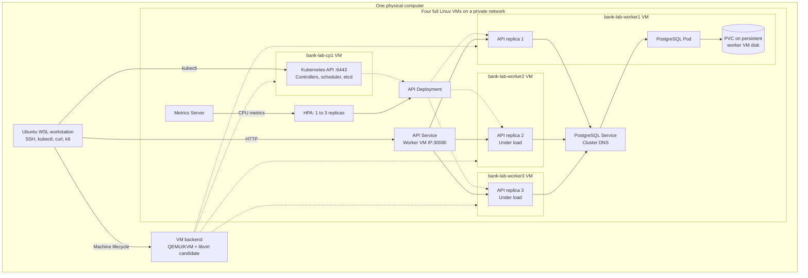

Planned architecture at three API replicas. Each VM has its own Linux kernel, disk, virtual NIC, IP address, and SSH access. The owner installs containerd and Kubernetes manually with kubeadm. The VM backend must pass its feasibility check first.

HPA scales the API across three existing workers. PostgreSQL starts as one persistent instance with backups exported outside the guest disks. Local storage stays tied to its worker. All VMs share one physical host; control-plane redundancy and physical host failover are outside this first experiment.
